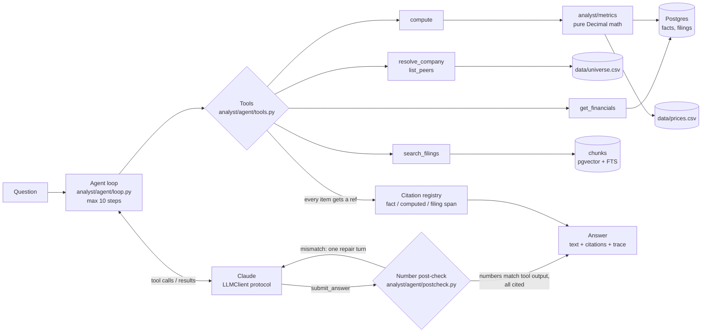

# analyst-agent

An AI financial analyst for public companies. Ask a question in plain English and get an
answer where **every number is computed deterministically and every claim is cited** to a
specific SEC filing passage or XBRL fact. It also runs banker workflows end to end: public
comps to a formula-driven Excel sheet, one-page tearsheets, and earnings briefs. A real eval
harness measures how accurate it is.

> Status: Part 3 of 6 in review (v0.3.0: data layer, filing search, and the cited analyst agent). See [PROGRESS.md](PROGRESS.md).

## What's inside (built in 6 parts)
1. **Data layer**: SEC EDGAR + XBRL ingestion into Postgres, normalized and traceable
2. **Retrieval**: section-aware hybrid search over 10-K/10-Q text with span-level citations
3. **Agent**: tool-using LLM analyst; math only in tested Python; number post-check; honest refusals
4. **Deliverables**: comps → Excel (live formulas), tearsheet PDF, earnings brief
5. **Evals**: auto-generated golden set from XBRL ground truth, citation validity, ablations, CI gate
6. **Product**: FastAPI + React UI with clickable citations, Docker, deployed demo, cost/latency tracing

## Building it with Claude Code
Open this folder in Claude Code and paste the prompt at the bottom of
`docs/parts/PART-N.md` for the current part (see `PROGRESS.md`). Claude Code reads
`CLAUDE.md` for the rules and builds one part per session.

## Part 1: Financial data layer

Pulls companies, filings and XBRL facts from SEC EDGAR into Postgres. Every value keeps its
provenance: concept, period, unit, filing accession and a fact id.

- **SEC client** (`analyst/edgar/client.py`): sends `SEC_USER_AGENT` on every request,
  stays under 8 req/s, retries 429/5xx with backoff, and caches every response under
  `data/raw/`, so re-runs cost no SEC requests.
- **Normalizer** (`analyst/edgar/concepts.py`): companies tag the same line item
  differently and change tags over time. Thirteen canonical items (`revenue`, `net_income`,
  `eps_diluted`, `total_assets`, `cash`, `total_debt`, `operating_cash_flow`, `capex`, …)
  map to ordered candidate tags. `get_series(session, cik, "revenue", "FY")` returns one
  value per period, from annual 10-K facts with ~365-day durations. When a value was
  restated, the latest filing wins. Each point carries its fact id and accession.
- **Quarters**: `--period Q` labels rows with the company's own fiscal year and quarter.
  Q4 isn't in any 10-Q, so for flow items like revenue it is derived as FY − (Q1+Q2+Q3) in
  `analyst/metrics/quarters.py`, with all four source facts cited. It is never derived for EPS.
- **Ingest** is idempotent: upserts write only rows whose values changed. It also saves
  the last 3 10-K and 4 10-Q documents to `data/raw/filings/` for Part 2.

```powershell
copy .env.example .env                 # set SEC_USER_AGENT="Your Name you@example.com"
docker compose up -d db                # Postgres on localhost:5433
uv sync --extra dev
uv run alembic upgrade head
uv run python -m analyst.edgar.ingest --universe data/universe.csv   # ~6 min cold, 0 requests warm
uv run python -m analyst.edgar.ingest --tickers AAPL MSFT            # or a few tickers
uv run python -m analyst.edgar.show AAPL revenue                     # FY table with accessions
uv run python -m analyst.edgar.show MSFT revenue --period Q
uv run pytest -rs                      # offline: recorded fixtures, no network
```

Re-fetch new filings with `--refresh`. Design notes: [ADR 0001](docs/adr/0001-idempotent-cached-ingest.md)
(caching and idempotency) and [ADR 0002](docs/adr/0002-per-period-concept-fallback.md)
(concept fallback).

## Part 2: Filing search with citations

Searches the text of the downloaded 10-Ks and 10-Qs and returns passages as citations:
accession, form, filing date, company, section, an exact character span into the stored
filing text, a snippet and the sec.gov URL. `resolve(citation)` returns exactly the cited
text, so every quote the agent makes later can be checked.

- **Parser** (`analyst/retrieval/parse.py`): HTML → clean text (inline XBRL header, hidden
  blocks, running headers/footers and page numbers dropped; tables kept as `a | b | c` rows).
  It labels each 10-K Item and 10-Q Part/Item, skipping the table of contents and the
  cross-reference indexes some filers put at the end ([ADR 0003](docs/adr/0003-section-detection.md)).
  Item 1A and Item 7 are found in **75/75** 10-Ks. 69/75 (92%) are substantive (≥ 2,000
  chars); WFC and USB put both in Exhibit 13, which isn't downloaded yet.
- **Chunker** (`chunk.py`): ~800-token chunks, ~100-token overlap, never across a section.
- **Index**: `filing_texts` (the clean text, stored once), `filing_sections`, and `chunks`
  with a pgvector HNSW index and a Postgres full-text GIN index. Embeddings come from
  `BAAI/bge-small-en-v1.5`, run locally on CPU (free).
- **Search** (`search.py`): vector top-50 + full-text top-50, fused with Reciprocal Rank
  Fusion, optional cross-encoder rerank, filters on company, form, section and date.

Each chunk is indexed and embedded with a short header ("Texas Instruments Inc (TXN), 10-K
filed 2025-02-14. Item 1: Business."), because filing text says "we", not the company's name.
The header is never part of a citation.

Retrieval eval, recall@5, open (all 25 companies) / ticker-filtered. A hit means the right
company and the right section appear in the top 5. Gold = 15 hand-written queries
(`tests/fixtures/retrieval_gold.yaml`). Held-out = 10 more, committed before the header change
was measured (`tests/fixtures/retrieval_holdout.yaml`):

| Retriever | gold (15) | held-out (10) | s/query (CPU) |
|---|---|---|---|
| vector-only (bge-small) | 15 / 15 | 10 / 10 | 0.48 |
| full-text-only (Postgres FTS + IDF, "BM25" leg) | 14 / 14 | 8 / 8 | 0.18 |
| hybrid (RRF) | 14 / 14 | 10 / 10 | 0.21 |
| hybrid + cross-encoder rerank | **15 / 15** | **10 / 10** | 7.61 |

The spec's target "hybrid ≥ both" is **met on the held-out set** (10 = 10 > 8) and **not on the
gold set**, where hybrid trails vector by one query (`orcl-capex`). Rerank gets every query but
is slow on CPU, so it's off by default. 450-token chunks tie with 800 (24/25 hybrid over all 25
queries), so chunks stay at 800. Details: [ADR 0004](docs/adr/0004-hybrid-retrieval.md).

```powershell
uv sync --extra dev --extra ml          # ml = sentence-transformers + torch (CPU)
uv run alembic upgrade head
uv run python -m analyst.retrieval.index              # parse + chunk + embed (~30 min on CPU)
uv run python -m analyst.retrieval.cli "supply chain risk" --ticker NVDA
uv run python -m analyst.retrieval.cli "goodwill impairment" --section "Item 7" --form 10-K -k 5
uv run python -m analyst.retrieval.evaluate --misses  # recall@5 on the 15-query gold set
uv run python -m analyst.retrieval.evaluate --misses --gold tests/fixtures/retrieval_holdout.yaml
uv run python scripts/section_survey.py               # section-detection stats
```

## Part 3: The analyst agent

Ask a question in plain English; get a short answer where every number and claim carries
a footnote to an XBRL fact, a computed value (with its formula and the facts behind it) or
an exact span of filing text.



- **The model never does arithmetic.** Reported values come from `get_financials` (XBRL
  facts, Q4 derived as FY − Q1−Q3 and cited to all four facts). Everything derived (growth,
  CAGR, LTM, margins, EBITDA, market cap, EV, EV/Revenue, EV/EBITDA, P/E, net debt/EBITDA,
  peer median/mean/quartiles) comes from `compute`, which calls pure functions in
  `analyst/metrics/` (100% test coverage). Each result is a `Computed(value, formula, inputs)`
  whose inputs name their facts.
- **Every number is checked against its citation.** When the model submits its answer, a
  post-check pulls every number out of the text and requires it to match a value of the
  `[^n]` ref cited in the same sentence: same kind (%, x, dollars vs shares), a sign that
  agrees ("fell 25%" fails against +25%; a loss written as "net income was $18.76B" fails),
  within the rounding it was written with
  ("$1.5 billion" matches 1,523,000,000; "$1.6 billion" doesn't). Only typed tool values
  count (never ids, dates or accession numbers). A failure gets one repair turn inside the
  10-step limit; if it still fails, the answer comes back flagged (`unverified_numbers`,
  `miscited_numbers`, `uncited_numbers`) at low confidence, never passed silently.
  Limits: claims without numbers are not checked for a citation, and small counts before a
  count word ("3 years") are treated as labels ([ADR 0005](docs/adr/0005-agent-loop-and-number-postcheck.md)).
- **Refuse rather than guess.** Companies outside `data/universe.csv` and line items a
  company doesn't report come back from the tools as "not in the filings"; a P/E with
  negative earnings is `None` with a note.
- **Trace and cost.** Every model call and tool call is timed; tokens and dollars are summed
  per run (Sonnet 5.5 prices in `analyst/llm/client.py`).
- **Prices are the weak spot.** SEC filings have no market prices, so multiples read
  `data/prices.csv` (`ticker,date,close`). `uv run python scripts/fetch_prices.py` refreshes
  it with completed daily closes from Yahoo Finance's public chart API (the file in the repo has
  closes up to 2026-11-23). Every result that uses a price cites the row it used. Market cap
  multiplies today's price by the latest reported share count. A count older than 400 days
  before the latest balance sheet is refused: Citigroup, PNC and Workday last tagged one 12-16
  years ago. Between 100 and 400 days it's used, with an age note. A stock split after that
  date would not be caught.

```powershell
uv run python -m analyst.agent.ask "How did NVIDIA's operating margin trend over the last three fiscal years?"
uv run python -m analyst.agent.ask "..." --json         # full Answer: citations, trace, usage
uv run pytest -m live tests/test_agent_live.py -s       # the 5 sample questions + refusals (costs ~$)
uv run python scripts/fetch_prices.py                   # refresh data/prices.csv (25 requests)
uv run python scripts/mutation_check_part3.py           # 48 guarantees, each broken once
```

## Quick start (fills in as parts land)
```powershell
copy .env.example .env      # add SEC_USER_AGENT and ANTHROPIC_API_KEY
docker compose up -d
uv sync --extra dev
uv run alembic upgrade head
uv run python -m analyst.edgar.ingest --universe data/universe.csv
```
