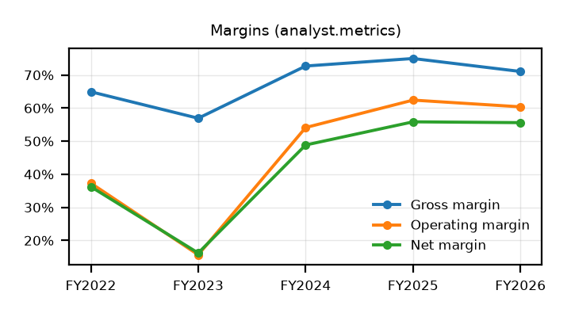

# NVIDIA CORP (NVDA)

_Semiconductors & Related Devices | fiscal year ends 01/31 | latest 10-K filed 2026-02-25 | price $165.05 on 2026-11-23_

## Business

NVIDIA describes itself as a data center scale AI infrastructure company whose accelerated computing platform combines GPUs, CPUs, DPUs, networking, systems and software, including the CUDA development platform [^1][^2]. Its offerings also include paid licenses for NVIDIA AI Enterprise and vGPU software [^2]. In the fiscal 2025 10-K it reports two segments. Compute & Networking covers Data Center platforms, networking, automotive and autonomous-vehicle solutions, Jetson robotics and DGX Cloud. Graphics covers GeForce GPUs, GeForce NOW, RTX workstation GPUs, vGPU software and Omniverse Enterprise [^3]. The filings name its customers and users as researchers and developers, gamers and creators, professional artists, architects and designers, and enterprises deploying AI [^4]. They also name ODMs, system integrators and distributors as partners that bring its products to market [^2].

## Financial summary (fiscal years, from XBRL)

| ($M, except EPS) | FY2022 | FY2023 | FY2024 | FY2025 | FY2026 |
|---|---|---|---|---|---|
| Revenue [^5] | 26,914 | 26,974 | 60,922 | 130,497 | 215,938 |
| Gross profit [^6] | 17,475 | 15,356 | 44,301 | 97,858 | 153,463 |
| Operating income [^7] | 10,041 | 4,224 | 32,972 | 81,453 | 130,387 |
| Net income [^8] | 9,752 | 4,368 | 29,760 | 72,880 | 120,067 |
| Diluted EPS [^9] | $3.85 | $0.17 | $1.19 | $2.94 | $4.90 |
| Operating cash flow [^10] | 9,108 | 5,641 | 28,090 | 64,089 | 102,718 |
| Gross margin [^11] | 64.9% | 56.9% | 72.7% | 75.0% | 71.1% |
| Operating margin [^12] | 37.3% | 15.7% | 54.1% | 62.4% | 60.4% |
| Net margin [^13] | 36.2% | 16.2% | 48.8% | 55.8% | 55.6% |

_Per-share values may mix split bases: the share count implied by net income / diluted EPS changes 10.1x from FY2022 to FY2023, which looks like a stock split; EPS before the jump is as originally reported, not split-adjusted._

## Top 5 risk factors (latest 10-K, Item 1A)

- **Supply/demand mismatch:** Long manufacturing lead times and uncertain supply, combined with inaccurate demand estimates, have led and could lead to excess inventory, write-downs, cancellation penalties and lower gross margins, amplified by non-cancellable purchase orders and growing purchase obligations [^14][^15].
- **Export controls and geopolitics:** US export controls on data center GPUs and possibly networking products have hurt and are likely to keep hurting demand in China and other markets, may disrupt the supply chain, and may disadvantage NVIDIA against competitors [^16][^17].
- **Competition:** Competitors, some with their own fabs and greater resources, and customers building in-house solutions could take market share and cut prices or demand for NVIDIA products [^18].
- **Third-party suppliers and manufacturing:** Reliance on third parties to manufacture, assemble, test and package products reduces control over quantity, quality, yields and delivery, and scaling new suppliers and US-based manufacturing adds complexity and delay risk [^15][^19].
- **Failure to meet evolving industry needs:** Rapid changes in technology, customer requirements and standards mean NVIDIA's results suffer if it cannot develop and launch products, software and services that meet evolving market needs [^20].

The ranking is my judgment. The filing doesn't rank its risk factors.

## Valuation snapshot

| Valuation [^21] | NVDA | Peer median |
|---|---|---|
| Market cap ($M) | 3,977,705 |  |
| Enterprise value ($M) | 3,988,628 |  |
| EV/Revenue | 13.2x | 13.3x |
| EV/EBITDA | 29.9x | 40.0x |
| P/E | 20.6x | 38.3x |

## Sources

[^1]: NVDA 10-K filed 2026-02-25, Item 1 (Business), accession 0001045810-26-000021, chars 10365-13509: "Item 1. Business
Our Company
NVIDIA pioneered accelerated computing to help solve the most challenging computational pro"
[^2]: NVDA 10-K filed 2026-02-25, Item 1 (Business), accession 0001045810-26-000021, chars 21502-25888: "ODMs, system integrators and distributors which we partner with to help bring our products to market. We also have partn"
[^3]: NVDA 10-K filed 2025-02-26, Item 1 (Business), accession 0001045810-25-000023, chars 17580-21826: "Headquartered in Santa Clara, California, NVIDIA was incorporated in California in April 1993 and reincorporated in Dela"
[^4]: NVDA 10-K filed 2026-02-25, Item 1 (Business), accession 0001045810-26-000021, chars 17113-21762: "Researchers and developers use our computing solutions to accelerate a wide range of important applications, from simula"
[^5]: Revenue: FY2022 us-gaap:Revenues (10-K 0001045810-24-000029, fact 269970); FY2023 us-gaap:Revenues (10-K 0001045810-25-000023, fact 269983); FY2024 us-gaap:Revenues (10-K 0001045810-26-000021, fact 269996); FY2025 us-gaap:Revenues (10-K 0001045810-26-000021, fact 270008); FY2026 us-gaap:Revenues (10-K 0001045810-26-000021, fact 270017)
[^6]: Gross profit: FY2022 us-gaap:GrossProfit (10-K 0001045810-24-000029, fact 257981); FY2023 us-gaap:GrossProfit (10-K 0001045810-25-000023, fact 257994); FY2024 us-gaap:GrossProfit (10-K 0001045810-26-000021, fact 258007); FY2025 us-gaap:GrossProfit (10-K 0001045810-26-000021, fact 258019); FY2026 us-gaap:GrossProfit (10-K 0001045810-26-000021, fact 258028)
[^7]: Operating income: FY2022 us-gaap:OperatingIncomeLoss (10-K 0001045810-24-000029, fact 263697); FY2023 us-gaap:OperatingIncomeLoss (10-K 0001045810-25-000023, fact 263710); FY2024 us-gaap:OperatingIncomeLoss (10-K 0001045810-26-000021, fact 263723); FY2025 us-gaap:OperatingIncomeLoss (10-K 0001045810-26-000021, fact 263735); FY2026 us-gaap:OperatingIncomeLoss (10-K 0001045810-26-000021, fact 263744)
[^8]: Net income: FY2022 us-gaap:NetIncomeLoss (10-K 0001045810-24-000029, fact 263046); FY2023 us-gaap:NetIncomeLoss (10-K 0001045810-25-000023, fact 263060); FY2024 us-gaap:NetIncomeLoss (10-K 0001045810-26-000021, fact 263074); FY2025 us-gaap:NetIncomeLoss (10-K 0001045810-26-000021, fact 263087); FY2026 us-gaap:NetIncomeLoss (10-K 0001045810-26-000021, fact 263097)
[^9]: Diluted EPS: FY2022 us-gaap:EarningsPerShareDiluted (10-K 0001045810-24-000029, fact 256004); FY2023 us-gaap:EarningsPerShareDiluted (10-K 0001045810-25-000023, fact 256017); FY2024 us-gaap:EarningsPerShareDiluted (10-K 0001045810-26-000021, fact 256030); FY2025 us-gaap:EarningsPerShareDiluted (10-K 0001045810-26-000021, fact 256042); FY2026 us-gaap:EarningsPerShareDiluted (10-K 0001045810-26-000021, fact 256051). Per-share values may mix split bases: the share count implied by net income / diluted EPS changes 10.1x from FY2022 to FY2023, which looks like a stock split; EPS before the jump is as originally reported, not split-adjusted.
[^10]: Operating cash flow: FY2022 us-gaap:NetCashProvidedByUsedInOperatingActivities (10-K 0001045810-24-000029, fact 262753); FY2023 us-gaap:NetCashProvidedByUsedInOperatingActivities (10-K 0001045810-25-000023, fact 262762); FY2024 us-gaap:NetCashProvidedByUsedInOperatingActivities (10-K 0001045810-26-000021, fact 262771); FY2025 us-gaap:NetCashProvidedByUsedInOperatingActivities (10-K 0001045810-26-000021, fact 262779); FY2026 us-gaap:NetCashProvidedByUsedInOperatingActivities (10-K 0001045810-26-000021, fact 262785)
[^11]: Gross margin = gross line / revenue, from the rows above (analyst.metrics.finance.margin)
[^12]: Operating margin = operating line / revenue, from the rows above (analyst.metrics.finance.margin)
[^13]: Net margin = net line / revenue, from the rows above (analyst.metrics.finance.margin)
[^14]: NVDA 10-K filed 2026-02-25, Item 1A (Risk Factors), accession 0001045810-26-000021, chars 70754-74769: "If we overestimate demand, or if customers cancel or defer orders or choose to purchase from our competitors, we may not"
[^15]: NVDA 10-K filed 2026-02-25, Item 1A (Risk Factors), accession 0001045810-26-000021, chars 58460-62939: "Item 1A. Risk Factors
The following risk factors should be considered in addition to the other information in this Annua"
[^16]: NVDA 10-K filed 2026-02-25, Item 1A (Risk Factors), accession 0001045810-26-000021, chars 145571-148846: "Export controls restricting our ability to sell data center GPUs may also negatively impact demand for our networking pr"
[^17]: NVDA 10-K filed 2026-02-25, Item 1A (Risk Factors), accession 0001045810-26-000021, chars 133111-137199: "Export controls have and could in the future disrupt our supply chain and distribution channels, negatively impacting ou"
[^18]: NVDA 10-K filed 2026-02-25, Item 1A (Risk Factors), accession 0001045810-26-000021, chars 66838-70753: "Competition could adversely impact our market share and financial results.
Our target markets remain competitive, and co"
[^19]: NVDA 10-K filed 2026-02-25, Item 1A (Risk Factors), accession 0001045810-26-000021, chars 74770-79432: "We continue to increase our supply and capacity purchases with existing and new suppliers to support our demand projecti"
[^20]: NVDA 10-K filed 2026-02-25, Item 1A (Risk Factors), accession 0001045810-26-000021, chars 62527-66912: "•Our business is exposed to the burden and risks associated with litigation, investigations, and regulatory proceedings."
[^21]: Valuation: comps workflow (analyst.workflows.comps), the same inputs as comps_NVDA_*.xlsx; EV = market cap + debt - cash, EBITDA = operating income + D&A, P/E = market cap / net income. Inputs: NVDA close 2026-11-23: data/prices.csv: NVDA,2026-11-23,165.05 | NVDA shares outstanding (cover page, 2026-08-21): dei:EntityCommonStockSharesOutstanding at 2026-08-21 = 24100000000 shares (10-Q 0001045810-26-000075, fact 274389) | NVDA total_debt FY2027 Q2: us-gaap:LongTermDebt at 2026-07-26 = 33366000000 USD (10-Q 0001045810-26-000075, fact 261988) | NVDA cash FY2027 Q2: us-gaap:CashAndCashEquivalentsAtCarryingValue at 2026-07-26 = 22443000000 USD (10-Q 0001045810-26-000075, fact 251359) | NVDA revenue LTM to 2026-07-26 [LTM to 2026-07-26]: us-gaap:Revenues 2025-07-28..2025-10-26 = 57006000000 USD (10-Q 0001045810-25-000230, fact 270016); us-gaap:Revenues 2025-01-27..2026-01-25 = 215938000000 USD (10-K 0001045810-26-000021, fact 270017); us-gaap:Revenues 2025-01-27..2025-04-27 = 44062000000 USD (10-Q 0001045810-26-000052, fact 270010); us-gaap:Revenues 2025-04-28..2025-07-27 = 46743000000 USD (10-Q 0001045810-26-000075, fact 270014); us-gaap:Revenues 2026-01-26..2026-04-26 = 81615000000 USD (10-Q 0001045810-26-000052, fact 270018); us-gaap:Revenues 2026-04-27..2026-07-26 = 96221000000 USD (10-Q 0001045810-26-000075, fact 270020) | NVDA operating_income FY2026 [FY2026]: us-gaap:OperatingIncomeLoss 2025-01-27..2026-01-25 = 130387000000 USD (10-K 0001045810-26-000021, fact 263744) | NVDA d_and_a FY2026 [FY2026]: us-gaap:DepreciationDepletionAndAmortization 2025-01-27..2026-01-25 = 2843000000 USD (10-K 0001045810-26-000021, fact 255305) | NVDA net_income LTM to 2026-07-26 [LTM to 2026-07-26]: us-gaap:NetIncomeLoss 2025-07-28..2025-10-26 = 31910000000 USD (10-Q 0001045810-25-000230, fact 263096); us-gaap:NetIncomeLoss 2025-01-27..2026-01-25 = 120067000000 USD (10-K 0001045810-26-000021, fact 263097); us-gaap:NetIncomeLoss 2025-01-27..2025-04-27 = 18775000000 USD (10-Q 0001045810-26-000052, fact 263090); us-gaap:NetIncomeLoss 2025-04-28..2025-07-27 = 26422000000 USD (10-Q 0001045810-26-000075, fact 263094); us-gaap:NetIncomeLoss 2026-01-26..2026-04-26 = 58321000000 USD (10-Q 0001045810-26-000052, fact 263099); us-gaap:NetIncomeLoss 2026-04-27..2026-07-26 = 59688000000 USD (10-Q 0001045810-26-000075, fact 263101). Peers: AMD, INTC, AVGO, QCOM, TXN, MU, ADI. Notes: bases differ: revenue LTM to 2026-07-26, EBITDA FY2026, net income LTM to 2026-07-26
